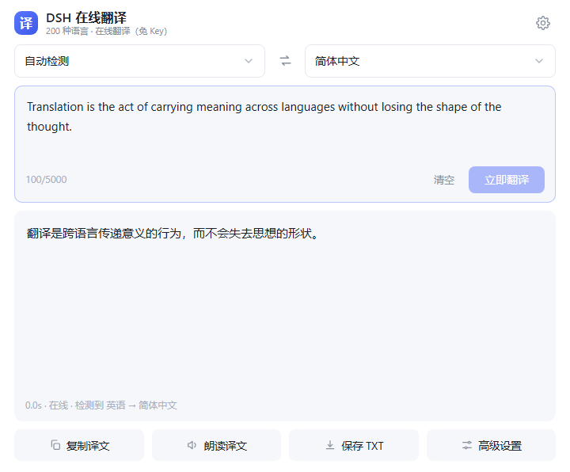
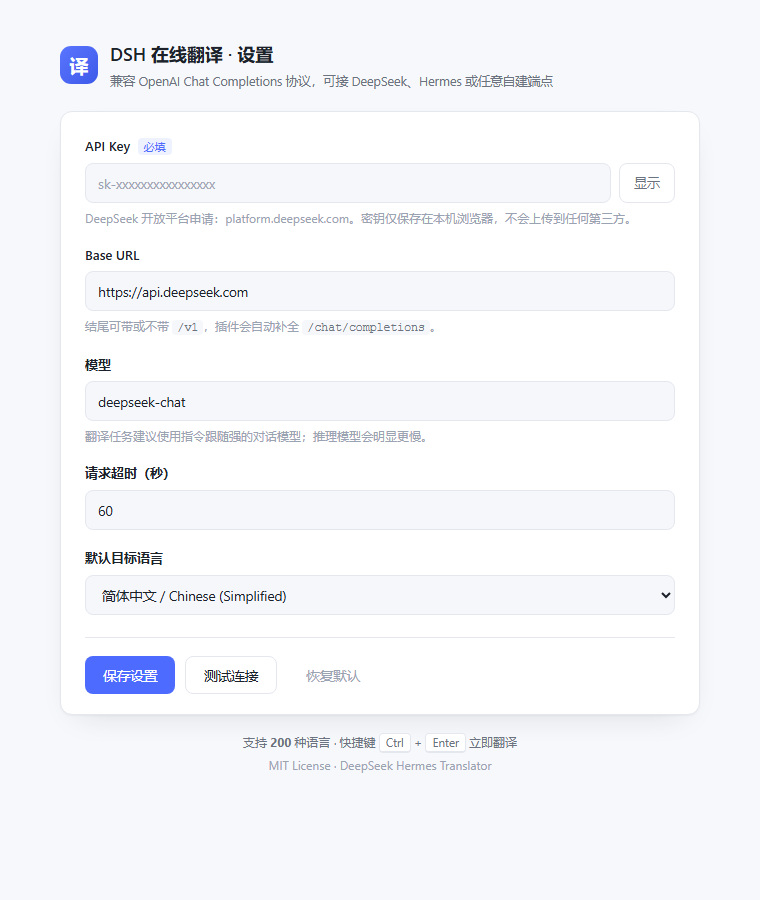
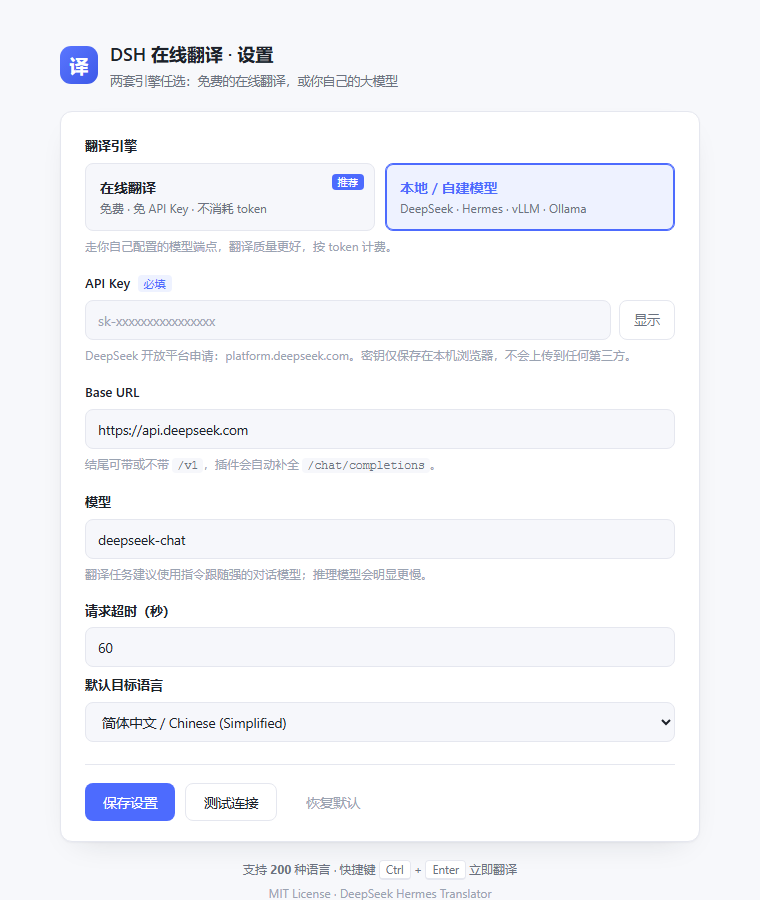

# DSH Translator · DeepSeek Hermes Translator


A minimal browser translation extension: **200 languages**, with two interchangeable engines — a free online translator, or your own model.

The UI follows the familiar Baidu Translate flow — pick languages, paste text, hit translate. Nothing else.

> 中文文档: [README.md](README.md)



---

## Two engines

| | Online (default) | Local / self-hosted model |
| --- | --- | --- |
| Setup | Works out of the box, no API key | Fill in API key / Base URL / model |
| Cost | Free, no tokens burned | Billed per token (or your own GPU) |
| Backend | MyMemory public API | Any OpenAI Chat Completions endpoint |
| Quality | Fine for everyday short text | Better — tone, terminology, context |
| Length | Auto-split into 460-char chunks | 5000 chars in a single request |
| Quota | ~5,000 chars/day anonymous, ~50,000 with an email | Depends on your account |

Switch with one click at the top of the settings page; the choice is saved automatically.

## Why this one

- **Translation only** — no accounts, no ads, no analytics, no third-party relay server
- **Works before you configure anything** — the free online engine is the default
- **Cheap when you want cheap, good when you want good** — flip between a free API and your own model
- **200 languages** — from English and Japanese to Cebuano, Northern Sami and Walloon
- **Your key stays local** — the API key lives in `chrome.storage.local` and is only sent to the endpoint you configure
- **No build step** — plain HTML/CSS/JS, edit and reload

## Features

| Feature | Description |
| --- | --- |
| Dual engine | Free online / self-hosted model, switchable in settings |
| 200 languages | Full built-in library, the 20 most used pinned on top |
| Language search | Filter by Chinese name, English name or language code |
| Concurrent chunks | Long text is split into 460-char chunks fetched 3 at a time, with one automatic retry per chunk |
| Auto detect | Pick "Detect language"; the online engine also reports what it detected |
| Swap | Swap source/target; the translation moves back into the input for round-trip work |
| Translate | Button, or `Ctrl + Enter` (`⌘ + Enter` on macOS) |
| Context menu | Select text on a page → right click → "Translate selection with DSH" |
| Result actions | Copy, read aloud with system TTS, export as `.txt` |
| Character counter | 5000 characters per request, counted live |
| Error messages | Unsupported language, quota exceeded, timeout and network failures each explained |

## Install

### Chrome / Edge (developer mode)

1. Download this repo: **Code → Download ZIP**, then unzip it to a permanent folder
2. Open `chrome://extensions` (`edge://extensions` on Edge)
3. Turn on **Developer mode** (top right)
4. Click **Load unpacked** and pick the folder that contains `manifest.json`
5. The options page opens automatically on first install; you can also click the gear icon in the panel

> Keep the unzipped folder in place — moving or deleting it breaks the extension.



## Configuration

### Online engine (default, start here)

Nothing to fill in. Optionally add an email to raise the daily quota:

| Setting | Default | Notes |
| --- | --- | --- |
| Contact email | empty | Optional. MyMemory allows ~5,000 chars/day anonymous, ~50,000 with an email |

### Local / self-hosted model

| Setting | Default | Notes |
| --- | --- | --- |
| API key | empty | Required. Create one at <https://platform.deepseek.com> → API keys |
| Base URL | `https://api.deepseek.com` | `/v1` is optional; `/chat/completions` is appended automatically |
| Model | `deepseek-chat` | Prefer instruction-tuned chat models; reasoning models are much slower |
| Timeout | 60 s | 5–300 s |



Click **Test connection** — if it returns a translated sentence, the pipeline works.

## Usage

1. Click the blue toolbar icon to open the panel
2. Choose the source language (auto detect by default) and the target language
3. Type or paste text, then click **Translate** or press `Ctrl + Enter`
4. The result appears below; the status bar shows the engine, elapsed time and detected language

**Language search** focuses automatically — typing `jap`, `日语` or `ja` finds Japanese. Use `↑ ↓` to move, `Enter` to pick, `Esc` to close.

**Selection translation**: select text on any page → right click → "Translate selection with DSH". On Chrome 127+ the panel opens and translates immediately; on older builds the toolbar icon shows a badge — click it to see the result.

## Using other models

The model engine only needs an endpoint implementing OpenAI's `POST /chat/completions`:

| Service | Base URL | Model name |
| --- | --- | --- |
| DeepSeek official | `https://api.deepseek.com` | `deepseek-chat` |
| DeepSeek official (v1) | `https://api.deepseek.com/v1` | `deepseek-reasoner` |
| Nous Hermes (hosted) | the OpenAI-compatible URL from your provider | `nousresearch/hermes-3-llama-3.1-70b` |
| Self-hosted vLLM | `http://192.168.10.250:8084/v1` | the value passed to `--served-model-name` |
| Ollama | `http://localhost:11434/v1` | `qwen2.5:7b` |
| One API / New API gateway | gateway URL + `/v1` | model name defined in the gateway |

Notes:

- **Ollama** binds to localhost and validates origins. Start it with `OLLAMA_ORIGINS=chrome-extension://*`
- **LAN endpoints** are covered by the declared `http://*/*` and `https://*/*` host permissions
- **Not supported**: streaming-only or non-standard protocols — this extension uses a single non-streaming request

## Language support

200 languages covering the world's major languages plus a long tail of regional ones. The first 20 are the most used (Chinese Simplified/Traditional, English, Japanese, Korean, Spanish, French, German, Russian, Portuguese, Italian, Arabic, Hindi, Thai, Vietnamese, Indonesian, Malay, Turkish, Dutch, Polish).

The full list lives in [`src/languages.js`](src/languages.js) as `[code, Chinese name, English name]` tuples — edit it and the panel, search and settings dropdown all follow.

> Coverage of the online engine depends on MyMemory's language-pair table. If you see "the online engine does not support this language", switch to the model engine.

## Privacy

- No data collection, no remote scripts or fonts
- **Online engine**: text is sent to `api.mymemory.translated.net`, a third-party public service, with no identity attached; if you set an email it is submitted only as a quota parameter
- **Model engine**: text goes only to **the API endpoint you configure**
- The API key is stored in local browser storage and used solely in that request header
- "Restore defaults" wipes all local data of this extension

## Project layout

```
deepseek-hermes-translator/
├── manifest.json          # Manifest V3
├── popup.html             # Translation panel
├── popup.css
├── popup.js               # Dropdowns, translation, copy / speak / export
├── options.html           # Settings (engine switch)
├── options.css
├── options.js
├── background.js          # Context menu, first-run onboarding
├── src/
│   ├── languages.js       # 200-language library
│   ├── online.js          # Online engine: chunking + MyMemory calls
│   └── translator.js      # Engine routing, model calls, error mapping
├── tests/
│   └── split.test.js      # Chunking unit tests
├── icons/                 # Icons + generator script (stdlib Python)
└── docs/                  # Screenshots
```

## Development

No npm, no bundler:

1. Edit the code → open `chrome://extensions` → click reload on the extension card
2. Debug the panel: right click inside it → Inspect
3. Run chunking tests: `node tests/split.test.js`
4. Regenerate icons: `python icons/make_icons.py` (standard library only)

## Known limitations

- 5000 characters per request; the online engine sends 460-char chunks three at a time — roughly 3× faster than the old sequential mode
- The online engine is bound by MyMemory's free quota — wait a day or switch to the model engine
- Non-streaming: long input returns all at once
- Read-aloud uses system TTS; rare languages may have no matching voice
- Not published on the Chrome Web Store — load it in developer mode

## Changelog

### v1.1.0

- **Concurrent chunking**: the online engine now fetches 460-char chunks 3 at a time instead of sequentially (~3× faster on long text); a failed chunk (network hiccup, HTTP 5xx) is retried once, while deterministic errors such as unsupported languages or quota are not retried
- **Status bar**: chunk count is now shown after long translations (e.g. `2.1s · online · 6 chunks · English → Chinese`)
- **Speak toggle**: click the speak chip again to stop playback immediately
- **Copy fallback**: falls back to a hidden textarea when the async clipboard API is unavailable
- **Robustness**: `chrome.action.openPopup` and `storage.session` are feature-detected and guarded; older Chrome builds fall back to the badge
- Fixed quote unwrapping for model output wrapped in quotation marks (now requires a matching pair, so real leading/trailing characters are never stripped)

### v1.0.0

- Initial release: dual engine (free online / self-hosted model), 200 languages, selection right-click translation, read-aloud and export

## Contributing

Issues and PRs are welcome — especially language table corrections and compatibility reports for more endpoints.

## License

[MIT](LICENSE)
